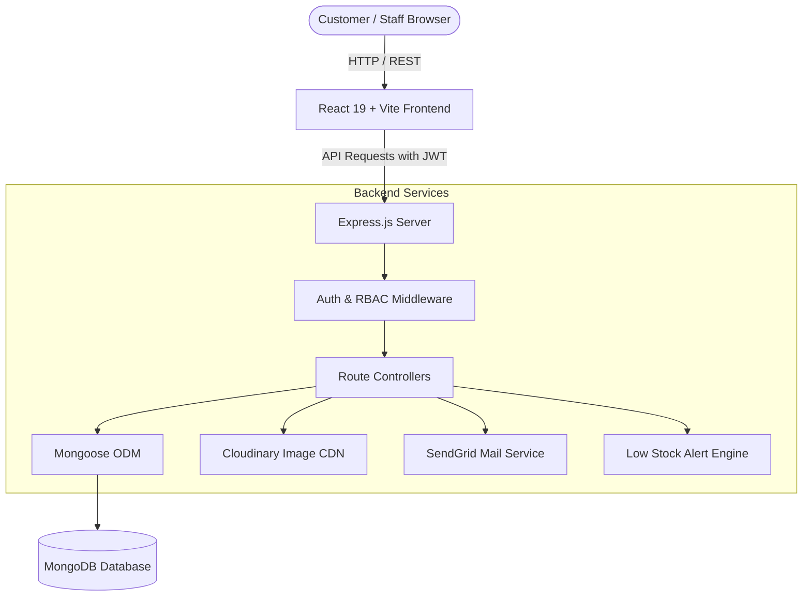

# 👗 StyleHub Frontend (Client)

The frontend for **StyleHub** is built with **React 19**, **Vite**, **Tailwind CSS**, and **Ant Design**.

## 🚀 Getting Started

### 1. Install Dependencies
```bash
npm install
```

### 2. Configure Environment
Copy `.env.example` to `.env`:
```bash
cp .env.example .env
```
Ensure `VITE_API_URL` points to your active backend (default: `http://localhost:5000`):
```env
VITE_API_URL=http://localhost:5000
```

### 3. Run Development Server
```bash
npm run dev
```
The app will be available at `http://localhost:5173`.

### 4. Build for Production
```bash
npm run build
```
The compiled static assets will be output to the `dist/` directory.

### 5. Preview Production Build
```bash
npm run preview
```

---

## 📦 Key Libraries & Technologies
- **React 19**: Core UI framework
- **Vite 8**: Next-generation frontend tooling and HMR dev server
- **Tailwind CSS 3.4**: Utility-first styling with responsive design
- **Ant Design 6**: Enterprise UI component library (forms, modals, tables, sliders)
- **Lucide React**: Modern iconography
- **React Router DOM 7**: Client-side routing with role-based route guards
- **Recharts**: Business intelligence analytics & interactive visual charts
- **Day.js**: Lightweight date parsing and range filtering


# 🛍️ StyleHub — Modern Fashion E-Commerce Platform

[](https://react.dev/)
[](https://vitejs.dev/)
[](https://tailwindcss.com/)
[](https://ant.design/)
[](https://nodejs.org/)
[](https://expressjs.com/)
[](https://www.mongodb.com/)
[](LICENSE)

**StyleHub** is an enterprise-grade, full-stack e-commerce web application tailored for a contemporary fashion boutique. It delivers a refined shopping experience for customers and a comprehensive administrative suite with multi-role access control, inventory automation, financial analytics, customer ticketing, and live promotional engines.

---

## 📑 Table of Contents

- [Key Features](#-key-features)
- [System Architecture](#-system-architecture)
- [Role-Based Access Control (RBAC)](#-role-based-access-control-rbac)
- [Technology Stack](#-technology-stack)
- [Project Structure](#-project-structure)
- [Prerequisites](#-prerequisites)
- [Environment Configuration](#-environment-configuration)
- [Installation & Quick Start](#-installation--quick-start)
- [Database Seeding](#-database-seeding)
- [REST API Reference](#-rest-api-reference)
- [Troubleshooting & FAQs](#-troubleshooting--faqs)

---

## ✨ Key Features

### 🛒 Customer Storefront
* **Boutique UI/UX**: Minimalist, luxury-inspired design powered by Tailwind CSS and Ant Design.
* **Curated Collections & Filters**: Explore Menswear, Womenswear, and Accessories with real-time multi-attribute filtering (subcategory, fabric, price range slider, size, and in-stock availability).
* **Interactive Product Details**: Multi-angle image gallery, size variant selector with dynamic stock countdowns (*"Only 2 left!"*), active discount badges, and customer ratings.
* **Persistent Shopping Bag**: Global cart state stored locally with automatic subtotal, coupon/category discount calculations, and shipping fee logic.
* **Streamlined Checkout**: Sri Lankan island-wide shipping address configuration, payment method selection (Cash on Delivery, Card, Bank Transfer), and instant order confirmation tracking.
* **Customer Account Dashboard**:
  - Personal profile and avatar management.
  - Interactive order history with chronological status pipeline (*Pending → Processing → Shipped → Delivered*).
  - Order cancellation capabilities (for eligible unfulfilled orders).
  - Customer review submission and history.
* **Customer Support Desk**: Direct inquiry and ticket submission for store assistance.
* **Dynamic Announcement Bar**: Admin-configurable marquee/slider for store promotions, shipping alerts, and flash sales.

### 🛡️ Administrative & Operations Suite
* **Executive Dashboard**: Real-time business overview (Gross Revenue, Total Orders, Active Catalog Count, Registered Customers, and Recent Activity).
* **Inventory & Product Management**:
  - Full product CRUD with multi-image Cloudinary CDN uploads.
  - Granular variant matrices (sizes `XS`, `S`, `M`, `L`, `XL`, etc.) with individual stock levels and threshold configurations.
  - One-click active/inactive catalog toggling.
* **Automated Low-Stock Alert System**: Built-in notification engine that detects when variant inventory drops below minimum thresholds and dispatches actionable alerts.
* **Promotional Discount Engine**: Apply scheduled percentage discounts across product categories with expiration date controls and live storefront sync.
* **Order Processing Hub**: Manage order fulfillment statuses, verify customer shipping details, view item breakdowns, and monitor payment states.
* **Financial Analytics & Reporting**:
  - Interactive visual charts (revenue trends, payment method share, order status distributions) powered by **Recharts**.
  - Flexible presets (Today, Week, Month, Custom Date Range) with print-ready reports and CSV export.
* **Staff & User Governance**: Manage customer accounts, invite and onboard staff members, and assign role authorizations.
* **Review Moderation**: Approve or decline customer reviews before they appear publicly.
* **Ticket Resolution Desk**: Review and resolve customer inquiries and support tickets.
* **Store Customization Settings**: Manage store contact info, delivery fees, free shipping thresholds, return policies, and promotional marquee banners.

---

## 🏛️ System Architecture



---

## 🔐 Role-Based Access Control (RBAC)

StyleHub enforces strict multi-tier role authorization on both frontend route guards and backend API endpoints:

| Feature / Section | Customer | Sales Staff | Inventory Handler | Owner | Developer |
| :--- | :---: | :---: | :---: | :---: | :---: |
| Storefront Browsing & Checkout | ✅ | ✅ | ✅ | ✅ | ✅ |
| Customer Profile & My Orders | ✅ | ✅ | ✅ | ✅ | ✅ |
| Admin Dashboard Overview | ❌ | ✅ | ✅ | ✅ | ✅ |
| Product Catalog Management | ❌ | ❌ | ✅ | ✅ | ✅ |
| Category Discounts & Thresholds | ❌ | ❌ | ✅ | ✅ | ✅ |
| Order Fulfillment & Status Updates | ❌ | ✅ | ❌ | ✅ | ✅ |
| Customer Support Tickets | ❌ | ✅ | ❌ | ✅ | ✅ |
| Financial Reports & Analytics | ❌ | ❌ | ❌ | ✅ | ✅ |
| Review Moderation | ❌ | ❌ | ❌ | ✅ | ✅ |
| User & Staff Management | ❌ | ❌ | ❌ | ✅ | ✅ |
| Store Settings & Brand Config | ❌ | ❌ | ❌ | ✅ | ✅ |

---

## 🛠️ Technology Stack

### Frontend (`client/`)
- **Framework**: [React 19](https://react.dev/)
- **Bundler & Dev Server**: [Vite 8](https://vitejs.dev/)
- **Styling**: [Tailwind CSS 3.4](https://tailwindcss.com/) + PostCSS
- **Component System**: [Ant Design 6](https://ant.design/)
- **Icons**: [Lucide React](https://lucide.dev/)
- **Routing**: [React Router DOM 7](https://reactrouter.com/)
- **Data Visualization**: [Recharts 3](https://recharts.org/)
- **Date Handling**: [Day.js](https://day.js.org/)

### Backend (`server/`)
- **Runtime Environment**: [Node.js](https://nodejs.org/) (v18+)
- **Web Framework**: [Express.js 4.19](https://expressjs.com/)
- **Database**: [MongoDB](https://www.mongodb.com/) via [Mongoose 8](https://mongoosejs.com/)
- **Authentication**: [JSON Web Tokens (jsonwebtoken)](https://jwt.io/) & [Bcrypt.js](https://github.com/dcodeIO/bcrypt.js)
- **Media Handling**: [Multer](https://github.com/expressjs/multer) & [Cloudinary SDK](https://cloudinary.com/)
- **Email Delivery**: [@sendgrid/mail](https://sendgrid.com/)
- **Security & Utilities**: CORS, Dotenv, Form-Data

---

## 📁 Project Structure

```text
├── client/                              # Frontend React + Vite Application
│   ├── public/                          # Static assets, favicon, manifest
│   ├── src/
│   │   ├── assets/                      # Curated imagery & style assets
│   │   ├── components/                  # Reusable UI components & Route Guards
│   │   │   ├── admin/                   # Category discounts modal & components
│   │   │   ├── AdminRoute.jsx           # Guard for admin role access
│   │   │   ├── AnnouncementBar.jsx      # Top dynamic promo marquee
│   │   │   ├── Auth.jsx                 # Login / Register modal dialog
│   │   │   ├── Navbar.jsx & Footer.jsx  # Primary navigation & footer
│   │   │   └── RoleRoute.jsx            # Granular RBAC role validator
│   │   ├── config/                      # API endpoint configurations
│   │   ├── context/                     # Global state (Auth, Cart, Settings)
│   │   ├── layouts/                     # Admin dashboard shell & sidebar
│   │   ├── pages/                       # Storefront pages (Home, Collections, Cart, Checkout, Profile)
│   │   │   └── admin/                   # Admin pages (Dashboard, Products, Orders, Reports, Users, etc.)
│   │   ├── App.jsx                      # Route definitions & Ant Design theme
│   │   ├── index.css                    # Tailwind CSS directives & global rules
│   │   └── main.jsx                     # Application entry point
│   ├── .env.example                     # Frontend environment template
│   ├── package.json                     # Client scripts and dependencies
│   ├── tailwind.config.js               # Tailwind design system configuration
│   └── vite.config.js                   # Vite configuration
│
└── server/                              # Backend Express.js REST API
    ├── config/                          # MongoDB connection & Cloudinary setup
    ├── controllers/                     # Business logic for all modules
    ├── middleware/                      # Auth protect & RBAC authorize handlers
    ├── models/                          # Mongoose Schemas (User, Product, Order, Review, etc.)
    ├── routes/                          # API route definitions
    ├── utils/                           # Stock alerts and SendGrid email utilities
    ├── seed.js                          # Developer account seeding script
    ├── seedProducts.js                  # Sample boutique product catalog seeder
    ├── server.js                        # Express server entry point
    ├── .env.example                     # Backend environment template
    └── package.json                     # Server scripts and dependencies
```

---

## ⚙️ Prerequisites

Before getting started, ensure you have the following installed on your machine:
- **Node.js**: `v18.0.0` or higher ([Download Node.js](https://nodejs.org/))
- **npm**: `v9.0.0` or higher
- **MongoDB**: Local MongoDB instance running on `mongodb://127.0.0.1:27017` or a cloud [MongoDB Atlas](https://www.mongodb.com/cloud/atlas) connection URI.

---

## 🔑 Environment Configuration

### 1. Server Environment (`server/.env`)
Create a `.env` file in the `server` directory (or copy from `server/.env.example`):

```bash
# Server Port
PORT=5000

# MongoDB Database Connection String
MONGODB_URI=mongodb://127.0.0.1:27017/clothingstore

# JWT Secret Token
JWT_SECRET=stylehub_jwt_super_secret_key_2026_!@#$

# Client URLs (for CORS and email redirects)
CLIENT_URL=http://localhost:5173
FRONTEND_URL=http://localhost:5173

# Default Seed Developer Credentials (used by `npm run seed`)
DEV_EMAIL=admin@stylehub.com
DEV_PASSWORD=AdminPassword123!

# Email Service (Optional for development; fallback console warnings provided)
SENDGRID_API_KEY=
FROM_EMAIL=noreply@stylehub.com

# Cloudinary Storage (Optional for development if using pre-seeded local images)
CLOUDINARY_CLOUD_NAME=
CLOUDINARY_API_KEY=
CLOUDINARY_API_SECRET=
```

### 2. Client Environment (`client/.env`)
Create a `.env` file in the `client` directory (or copy from `client/.env.example`):

```bash
# Backend REST API URL
VITE_API_URL=http://localhost:5000
```

---

## 🚀 Installation & Quick Start

### 1. Clone the Repository
```bash
git clone https://github.com/TharushiPabasara/StyleHub.git
cd StyleHub
```

---

### 2. Install & Start the Server

```bash
# Navigate to the server folder
cd server

# Install dependencies
npm install

# (Optional) Seed the database with the Developer account and initial products
npm run seed:all

# Start the server in development mode (with nodemon)
npm run dev
```

The backend server will start on `http://localhost:5000`.

---

### 3. Install & Start the Client

Open a second terminal window:

```bash
# Navigate to the client folder
cd client

# Install dependencies
npm install

# Start the Vite development server
npm run dev
```

The frontend client will launch at `http://localhost:5173`. Open your browser and navigate to this address!

---

## 🌱 Database Seeding

StyleHub comes equipped with ready-to-use seeding scripts to instantly bootstrap your local environment:

| Command | Purpose |
| :--- | :--- |
| `npm run seed` | Creates/resets the pre-verified **Developer account** (`admin@stylehub.com`). |
| `npm run seed:products` | Populates the database with initial curated luxury clothing products and sizes. |
| `npm run seed:all` | Executes both seeders in sequence for a complete out-of-the-box store setup. |

### Default Developer Credentials:
* **Email**: `admin@stylehub.com`
* **Password**: `AdminPassword123!`
* **Role**: `developer` (unrestricted access to all admin sections)

---

## 📡 REST API Reference

All API routes are prefixed with `/api`. Protected routes require a Bearer token in the `Authorization` header (`Bearer <token>`).

### 1. Authentication (`/api/auth`)
| Method | Endpoint | Access | Description |
| :--- | :--- | :--- | :--- |
| `POST` | `/api/auth/register` | Public | Register a new customer account |
| `POST` | `/api/auth/login` | Public | Authenticate user & return JWT token |
| `GET` | `/api/auth/verify/:token` | Public | Verify email address token |
| `POST` | `/api/auth/forgotpassword` | Public | Request password reset token via email |
| `PUT` | `/api/auth/resetpassword/:token`| Public | Reset password using verified token |

### 2. Products & Inventory (`/api/products`)
| Method | Endpoint | Access | Description |
| :--- | :--- | :--- | :--- |
| `GET` | `/api/products` | Public | Fetch filtered & paginated product catalog |
| `GET` | `/api/products/:id` | Public | Get single product by ID |
| `POST` | `/api/products` | Staff / Owner | Create product with image uploads |
| `PUT` | `/api/products/:id` | Staff / Owner | Update existing product & variant details |
| `DELETE`| `/api/products/:id` | Staff / Owner | Remove product from database |
| `PATCH`| `/api/products/:id/status` | Staff / Owner | Toggle product active/inactive state |
| `GET` | `/api/products/low-stock` | Staff / Owner | Retrieve variants falling below threshold |

### 3. Orders & Checkout (`/api/orders`)
| Method | Endpoint | Access | Description |
| :--- | :--- | :--- | :--- |
| `POST` | `/api/orders` | Public / Customer | Place a new customer order |
| `GET` | `/api/orders/myorders` | Customer | Fetch current logged-in customer's orders |
| `GET` | `/api/orders` | Staff / Owner | Retrieve all store orders for fulfillment |
| `PUT` | `/api/orders/:id/status` | Staff / Owner | Update order fulfillment status |
| `PUT` | `/api/orders/:id/cancel` | Customer | Cancel eligible order |

### 4. Category Discounts (`/api/discounts`)
| Method | Endpoint | Access | Description |
| :--- | :--- | :--- | :--- |
| `GET` | `/api/discounts/active` | Public | Retrieve active category discounts for store |
| `GET` | `/api/discounts` | Inventory / Owner | List all promotional discount campaigns |
| `POST` | `/api/discounts` | Inventory / Owner | Create a new category discount |
| `PUT` | `/api/discounts/:id` | Inventory / Owner | Update discount percentage or duration |
| `PATCH`| `/api/discounts/:id/status` | Inventory / Owner | Activate or deactivate discount |
| `DELETE`| `/api/discounts/:id`| Inventory / Owner | Delete discount campaign |

### 5. Financial Dashboard & Reports (`/api/dashboard` & `/api/reports`)
| Method | Endpoint | Access | Description |
| :--- | :--- | :--- | :--- |
| `GET` | `/api/dashboard/overview` | Staff / Owner | Get revenue, order counts, and stats summary |

### 6. Notifications & Low Stock (`/api/notifications`)
| Method | Endpoint | Access | Description |
| :--- | :--- | :--- | :--- |
| `GET` | `/api/notifications` | Staff / Owner | Get in-app alerts and notifications |
| `GET` | `/api/notifications/unread-count`| Staff / Owner | Get total unread notifications count |
| `PUT` | `/api/notifications/mark-all-read`| Staff / Owner | Mark all notifications as read |
| `POST` | `/api/notifications/scan-low-stock`| Staff / Owner | Trigger immediate inventory stock scan |

### 7. Support Tickets (`/api/tickets`)
| Method | Endpoint | Access | Description |
| :--- | :--- | :--- | :--- |
| `POST` | `/api/tickets` | Public / Customer | Submit a support ticket from Contact page |
| `GET` | `/api/tickets` | Sales / Owner | View all customer inquiries |
| `PUT` | `/api/tickets/:id/status` | Sales / Owner | Update ticket resolution status |

### 8. Reviews (`/api/reviews`)
| Method | Endpoint | Access | Description |
| :--- | :--- | :--- | :--- |
| `GET` | `/api/reviews` | Public | List approved public customer reviews |
| `POST` | `/api/reviews` | Customer | Submit a product/store review |
| `GET` | `/api/reviews/admin` | Owner / Developer | List all reviews pending moderation |
| `PUT` | `/api/reviews/:id/status` | Owner / Developer | Approve, reject, or archive a review |

### 9. Store Settings (`/api/settings`)
| Method | Endpoint | Access | Description |
| :--- | :--- | :--- | :--- |
| `GET` | `/api/settings/contact` | Public | Fetch dynamic store policies, fees, & announcements |
| `PUT` | `/api/settings/contact` | Owner / Developer | Update store contact details, shipping fee, banners |

---

## ❓ Troubleshooting & FAQs

### 1. MongoDB Connection Error (`MongooseServerSelectionError`)
* **Solution**: Ensure your MongoDB daemon is running locally (`net start MongoDB` on Windows or `brew services start mongodb-community` on macOS). If using MongoDB Atlas, check your network whitelist (IP Access List) to allow connections from your current IP.

### 2. Emails are not sending via SendGrid
* **Solution**: If `SENDGRID_API_KEY` is not supplied, StyleHub gracefully logs a warning to the server console rather than crashing. For local development, user accounts created during registration can be verified manually or you can use the pre-verified developer seed account.

### 3. Product image upload issues
* **Solution**: In development mode, the app includes fallback local images in `client/public/images/`. If uploading new images via the Admin panel, provide valid Cloudinary credentials in `server/.env`.

---

## 📄 License

This project is licensed under the MIT License — see the [LICENSE](LICENSE) file for details.
